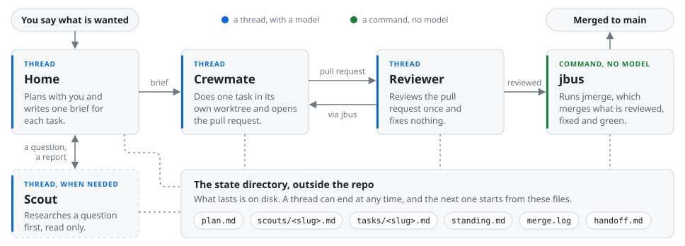

# jstack

jstack turns a repo's backlog into reviewed, merged pull requests while you do something else.
You tell a home thread in T3 Code what you want done.
It plans the work with you, writes a brief for each task, and starts an agent thread for each one in a worktree of its own.
Each thread does its task, opens a pull request, has it reviewed, and fixes what the review finds.
`jmerge` merges each pull request once it is reviewed, fixed and green.
You answer the questions only you can answer, and the rest goes on without you.

**Status: experimental.** Commands, flags, files and skills can change with no notice and no migration.

It is for a developer who uses Claude Code and wants more than one agent at work on a repo at a time.
Every thread spends tokens on your own Claude plan: one task is at least a crewmate thread and a reviewer thread, and `jgauge session` prints what a thread cost.
It runs on Linux only.



- A **home** thread plans with you, writes a brief for each task, and launches a thread for it.
- A **crewmate** thread does the one task in its brief, opens the pull request, and fixes what the review finds.
- A **scout** thread researches a question with read-only tool calls before a task is briefed.
- A **reviewer** thread reviews one pull request and fixes nothing.

[How a task flows](features/home/docs/flow.md) has every step of the picture, and what you are asked for along the way.

What lasts is on disk, in a state directory outside the repo, so a thread can end at any time and the next one starts from those files.
A thread does reversible work without asking.
It pauses only before a force-push to a shared branch, a deploy, deleting data, or a message to anyone outside.
A question only you can answer becomes a **gate**: the thread takes a default, carries on, and asks you, and the gate closes when you answer or keeps its default.
Nine commands do the routine work with no model, from `jmerge`, which merges, to `jpack`, which checks context packs: [Reference](#reference) lists them all.

## Requirements

jstack does not run without a **hard** need.
`jinstall --doctor` checks each one.

| Need | Level | Notes |
|---|---|---|
| Linux | hard | The only platform. |
| T3 Code, the nightly build | hard | T3 Code, from `pingdotgg/t3code` on GitHub, is the desktop app the threads run in, with Claude Code as their agent. Any nightly build. The doctor refuses the stable build and names no oldest nightly yet. jstack is tested on `0.1.2-nightly.20261022.3526`. |
| Claude Code | hard | The `claude` command on `PATH`. |
| `uv` | hard | It installs the nine commands as one tool, `jstack`. |
| `git` | hard | 2.31 or newer. |
| `jq` | hard | 1.6 or newer. |
| `gh`, signed in | hard | `gh auth login`. The threads open pull requests with it, and `jmerge` merges with it. |

The commands run on Python 3.12 or newer.
`uv` uses a Python it finds on the machine, and downloads one when it finds none.
The commands also install `tzdata`, their one package, and read your time zone from it where the system has no zone files.

An **optional** need switches a layer on.
jstack runs without it.

| Need | What you lose without it |
|---|---|
| `jbus`, with its config, its sign-in and a webhook | Nothing runs between your threads, so the work moves only while a home is open, and you run `jmerge` yourself or hand the merge to a home. With no webhook, `jbus` works and sends no event, and asks you each hour to set `webhook_url` and `webhook_key`. |
| systemd `--user` | No background jobs. The install enables these timers: the `jbus` pass each minute, its check for a missing pass, `jgauge-limits` and `jgauge-sample`, and `jroles-mirror`. It enables the weekly CI report, the relay and the backup only once their config is there. |
| The limits file, `~/.local/state/claude/limits` | `jgauge room` cannot see the plan's five-hour and weekly limits, so a launch is held back for the machine alone. `jinstall` sets a status line that writes the file, unless you have a status line of your own. |
| The backup: a private remote and `gitleaks` | The homes' state directory is not pushed anywhere. With an `origin` on `~/.local/state/home` and `gitleaks` on the machine, a timer commits and pushes it twice a day ([Back up the homes' state](features/jbus/docs/jbus/back-up-the-homes-state.md)). |
| `lavish-axi` | No visual pages. A scout writes its report with no page, and a round of questions is asked as text. |

The threads run on Claude Code, and the install also links the skills for Codex and Cursor.
It writes outside jstack's own folders for each of the three.
`jinstall --uninstall` takes its links, hook entries, keys and units away again:

- Claude Code: a link for each skill in `~/.claude/skills`, and hook entries, a status line and the attribution keys in `~/.claude/settings.json`.
- Codex: a link for each skill in `~/.codex/skills`, and hook entries in `~/.codex/hooks.json`.
- Cursor: a link for each skill in `~/.agents/skills`, and the attribution keys in `~/.cursor/cli-config.json` once Cursor's CLI has made it.
- systemd: the units, linked in `~/.config/systemd/user`.
- Configs, where none is there: `~/.config/jstack/config.toml`, a role map, and a `jbus` config that launches nothing.

[jinstall](features/jinstall/docs/jinstall.md) lists every file, and [AI co-author trailers](features/jinstall/docs/jinstall.md#ai-co-author-trailers) says which keys it sets.

## Quickstart

In this tutorial we install jstack, point it at a repo of yours, and merge one pull request that its threads wrote.

1. Install the latest release and set it up. The install script itself needs only `curl` and a shell.

	```sh
	curl -fsSL https://github.com/JoshuaHayesWasHere/jstack/releases/latest/download/install.sh | sh
	```

	The script installs `uv` when it is missing, installs the nine commands as the `uv` tool `jstack`, and runs `jinstall --setup`.
	With `uv` already there, you can do the same by hand, for one version:

	```sh
	uv tool install git+https://github.com/JoshuaHayesWasHere/jstack@v<version>
	jinstall --setup
	```

	Setup prints one line for each need: `done <name>`, `already <name>`, `needs you <name> -> <command>`, or `missing optional <name> -> <command>`.
	Run each command a `needs you` line names, such as `gh auth login`, then run `jinstall --setup` again until no `needs you` line is left.
	A `missing optional` line is a layer you may leave off.

2. Check the install.

	```sh
	jinstall --check
	```

	You see one line for each part it put, and every line starts with `ok`.

3. Check the machine.

	```sh
	jinstall --doctor
	```

	You see a line for each requirement, then the lines of step 2, and `doctor: ok` last.
	A `missing optional` line names a layer you have not set up.
	Every other `missing` or `old` line has an entry in [Troubleshooting](features/jinstall/docs/troubleshooting/the-doctor.md).

4. Pick the repo that you want work done in.
	It needs a GitHub remote that `gh` can push to, and a CI check named `check` that runs on each pull request, since `jmerge` merges only once that check passes.
	A job named `check` in a workflow under `.github/workflows/` that runs `on: pull_request` gives the check its name: GitHub's guide [Quickstart for GitHub Actions](https://docs.github.com/en/actions/get-started/quickstart) shows how to write one.
	To wait on other checks too, list their names, one a line, in `required-checks` in the state directory of step 5 ([What ready means](features/jmerge/docs/jmerge.md#what-ready-means)).

5. Open T3 Code, start a thread in any project, and type the command below with the path of the repo's main checkout.

	```text
	/new-home <path>
	```

	You see one line for each part of the repo's first home: `done`, `already`, or `needs you` with what to do.
	It makes the state directory, `~/.local/state/home/<repo>`, where `<repo>` is the checkout's folder name.
	It adds the repo to T3 Code as a project and to the `jbus` config, and links jleak's git hooks, which refuse a push that leaks what must stay private and strip AI co-author lines from commits.
	A `needs you` line asks for what only you know, such as the repo's local check command, which goes in `fresh-check` there (`make check`, where the repo has that target).
	Last, it starts the home thread, and you see a short status of the repo there.
	Once that home ends, the next thread you open in the project becomes the home by itself.

6. Tell the home one small task.
	You see it ask you about the plan, write a brief, and start a crewmate thread, which shows up in T3 Code's thread list with a worktree of its own.

7. Watch the crewmate.
	You see it do the task, run the check command of `fresh-check`, open a pull request, and start a reviewer thread.
	Then it fixes what the review found, and says that the pull request is fixed and green.

8. Merge. In the repo's main checkout, run `jmerge`.

	```sh
	jmerge
	```

	You see `merged` or `wait` and the reason for each open pull request.
	`jmerge` merges each one that is reviewed, fixed and green, then removes its worktree and its branch.
	No person has to approve on GitHub: the reviewer thread's review is the review.

Nothing merges by itself until you choose who does it.
Set up [`jbus`](features/jbus/docs/jbus/set-up-jbus.md), and its timer runs `jmerge` each minute.
Or let one home merge: the home writes its thread id into `home-id` in the state directory when it starts, and you write that id, on one line, into a file `home-thread` beside it.
[Configuration](features/jinstall/docs/configuration.md#switches-for-one-repo) has both.
To add jleak's git hooks to another repo, run `jinstall --repo` in it ([Git hooks in your repos](features/jinstall/docs/jinstall.md#git-hooks-in-your-repos)).

To remove jstack from the machine, run `jinstall --uninstall`, then `uv tool uninstall jstack`.

## Reference

Each command has one page.

<!-- generated: commands by scripts/generate-jstack-trees.py, do not edit -->
| Command | Page | What it does |
|---|---|---|
| `jbriefs` | [features/jbriefs/docs/jbriefs.md](features/jbriefs/docs/jbriefs.md) | Writes one HTML page of every home, plan and brief. |
| `jbus` | [features/jbus/docs/jbus.md](features/jbus/docs/jbus.md) | Does a home's routine work from a timer, so a repo can run with no home thread. |
| `jdrift` | [features/jdrift/docs/jdrift.md](features/jdrift/docs/jdrift.md) | Lists what changed upstream in the files taken from pstack. |
| `jgauge` | [features/jgauge/docs/jgauge.md](features/jgauge/docs/jgauge.md) | Counts what a thread cost in tokens, and says whether there is room for one more. |
| `jinstall` | [features/jinstall/docs/jinstall.md](features/jinstall/docs/jinstall.md) | Installs, checks and removes jstack on a machine: install.sh in a checkout, and the jinstall command from a release. |
| `jleak` | [features/jleak/docs/jleak.md](features/jleak/docs/jleak.md) | Finds what must not leave the machine for a public repo, before a push or a pull request, and keeps AI co-author trailers out of commits and pull requests. |
| `jmerge` | [features/jmerge/docs/jmerge.md](features/jmerge/docs/jmerge.md) | Merges every pull request that is reviewed, fixed and green. |
| `jpack` | [features/jpack/docs/jpack.md](features/jpack/docs/jpack.md) | Checks a context pack. |
| `jroles` | [features/jroles/docs/jroles.md](features/jroles/docs/jroles.md) | Picks the model for a role from the role map. |
<!-- generated: end -->

| Page | Read it to |
|---|---|
| [Configuration](features/jinstall/docs/configuration.md) | Find every file you write, with each key, its default and who reads it. |
| [Troubleshooting](features/jinstall/docs/troubleshooting/the-doctor.md) | Fix a line the doctor or `jinstall --check` printed, a thread that did not become a home, or a `wait:` from `jgauge room`. |
| [The Chef](features/jbus/docs/chef.md) | Make the agent behind a `jbus` webhook. |
| [Hooks](features/home/docs/hooks.md) | See what the start hook and the gauge hook do. |
| [State](features/home/docs/state.md) | Find the files a home and its threads keep, and who tells whom. |
| [Playbooks, principles and templates](features/home/docs/playbooks.md) | Give a task numbered steps. |

## Skills

`features/` holds every skill, and [the catalog](CATALOG.md) lists each one by its feature.
Several names come from pstack, the agent skills by Lauren Tan for Cursor that jstack takes its principles from: `poteto-help`, `setup-pstack` and the `jdrift` command, which lists what changed in pstack's files.
Eight skills run the flow, `poteto-help` as the way in.
Each `SKILL.md` is the full text of what its thread does.

| Skill | Typed as | What the thread does |
|---|---|---|
| `home` | `/home`, `/home <scope>` | Becomes the repo's home, or the home of one scope. It reads the handoff, the plan and the notes, plans with you, writes each brief and launches its crewmate. It does none of the work itself. |
| `crew` | `/crew <slug>` | Becomes a crewmate. It does the task in `tasks/<slug>.md` in its own worktree, opens the pull request when the brief says so, appends its Result to the brief, and stays on the pull request. |
| `scout` | `/scout <slug>` | Becomes a scout. It answers the questions in `scouts/<slug>.md`, appends its report, and writes a crewmate's brief or a visual page when the request asks for one. It changes nothing in the repo. |
| `pr-review` | `/pr-review`, `/pr-review <slug>` | Launches one review thread in the crewmate's worktree. It reads the diff, judges what it found, and proves with one command the fact the change is safe because of. It runs no test suite. |
| `handoff` | `/handoff` | Closes a home. It updates the plan and the notes, archives the old handoff, and writes a one-page handoff for the next home. |
| `nohome` | `/nohome`, `/nohome repo`, `/nohome on`, `/nohome merge`, `/nohome merge on` | Opts this thread, or every new thread in the repo, out of the automatic home, or switches it back on. With `merge` it switches the repo's automatic merge off or on. |
| `new-home` | `/new-home <repo>` | Sets up a repo's first home, from any thread: its state directory, its T3 Code project, its table in the config of `jbus`, what it lacks for a merge, and its home thread. It does only what is missing. |
| `poteto-help` | `/poteto-help <question>`, `/poteto-help <slug>` | Answers a help question and starts no work. It names the role to type, the playbook and the skills that fit a brief or a question, each with its file. "Get set up" points at the Quickstart above. |

The others are loaded by name.
`/setup-pstack` runs `jinstall --setup` and the doctor on this machine, or `install.sh --setup` in a checkout, and reports what is left for you.
`/expert <name>` makes a thread the expert of one subject, and the rest are tools, such as `/architect`, `/create-formal-verification-skill`, `/unslop` and `/technical-writing`.
`THIRD_PARTY.md` lists where each came from.

## Contributing

The repo takes issues and pull requests: [CONTRIBUTING.md](CONTRIBUTING.md) says how to report a bug, open a pull request, and run the checks, and [SECURITY.md](SECURITY.md) says how to report a vulnerability.

## License

MIT. See [LICENSE](LICENSE).
