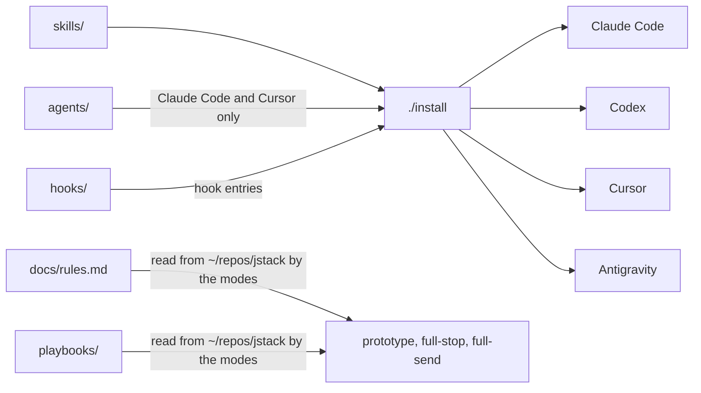
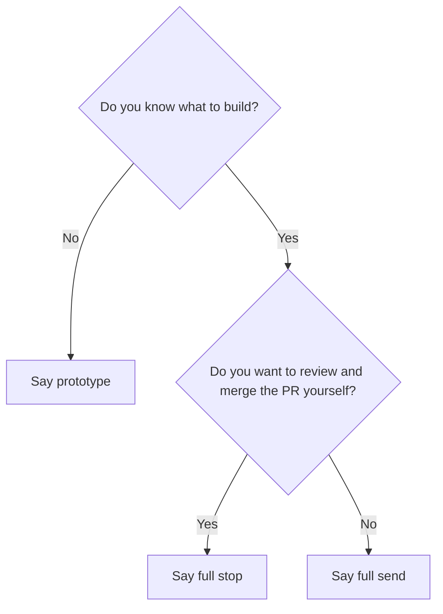

jstack is one repository that decides how every coding agent on this machine works. Claude Code, Codex, Cursor, and Antigravity all read the same skills, rules, and playbooks from it.

This diagram shows how the parts of the repository reach each agent. `install` links skills into each agent's folders, links agents for Claude Code and Cursor, and writes hook entries for every agent. The three modes read `docs/rules.md` and the playbooks from the checkout.

You pick how far an agent goes by the phrase you use:

| You say | The agent | It stops at |
| --- | --- | --- |
| ["prototype"](https://github.com/JoshuaHayesWasHere/jstack/blob/main/skills/prototype/SKILL.md) | Tries several approaches on throwaway branches. | A report, then asks you what to keep. |
| ["full stop"](https://github.com/JoshuaHayesWasHere/jstack/blob/main/skills/full-stop/SKILL.md) | Builds one change, proves it, and opens a PR. | A PR ready for you to merge. |
| ["full send"](https://github.com/JoshuaHayesWasHere/jstack/blob/main/skills/full-send/SKILL.md) | Does the same, unattended. | A merged PR. |

Every other skill supports those three modes. You can also run any skill on its own.

This decision tree shows which phrase to use for a task.

## Start here

- New to jstack: follow [[Your first prototype]].
- Setting up a machine: [[Install jstack]].
- Looking for a skill: start at [[Modes]], then [[Skills]].
- Want the reasons behind the design: [[Why jstack exists]].

## Where things come from

jstack takes skills from [pstack](https://github.com/cursor/plugins/tree/main/pstack) by Lauren Tan and [tstack](https://github.com/t3dotgg/tstack) by Theo Browne. Both are MIT licensed. [[Update from upstream]] says how jstack tracks them.
