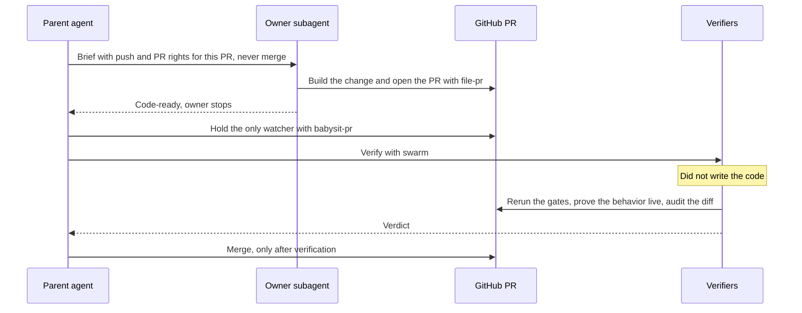

An agent that works unattended needs clear limits. A question it asks while you are away goes unread, so the limits must be written down before the run starts. jstack sets them in four places.

## Each mode grants only what it names

A mode lists what the agent may do without asking. Anything outside that list needs your answer first. [`full-send`](https://github.com/JoshuaHayesWasHere/jstack/blob/main/skills/full-send/SKILL.md) may merge this task's PRs. [`full-stop`](https://github.com/JoshuaHayesWasHere/jstack/blob/main/skills/full-stop/SKILL.md) may open a PR but never merge. [`prototype`](https://github.com/JoshuaHayesWasHere/jstack/blob/main/skills/prototype/SKILL.md) may never open a PR. Some actions always need your answer, whatever the mode: deploys, deleted data, a force-push to a shared branch, and messages to people outside the run.

One rule has no exception. No agent may disable, skip, or soft-fail a check to get a green result. A disabled check stops guarding every case, not only the one it blocked.

## Subagents get less than their parent

A mode often starts subagents to do parts of the work. Every subagent reads `docs/subagents.md` first. It may not push, open a PR, close a PR, or merge unless its brief grants that for a named branch or PR.

When `full-send` runs several PRs, each PR gets an owner subagent. The owner builds the change, opens the PR, and stops when the code is ready. The parent agent takes over from there. It holds the only watcher on the PR. It sends a separate set of agents, which did not write the code, to verify it. Only then does it merge. This split exists because the agent that wrote the code wants it to pass.

This sequence diagram shows one PR in a several-PR `full-send` run.

## Questions go where you see them

A plain message at the end of an unattended run looks like a finished thread. jstack modes ask through the harness's question tool instead, so the thread shows that it waits for you. If no question tool exists, `full-send` leaves the PR open and starts its final message with the question.

## Deletion needs proof

The [`worktree-cleanup`](https://github.com/JoshuaHayesWasHere/jstack/blob/main/playbooks/worktree-cleanup.md) playbook deletes worktrees and caches. No mode's grant covers it, so it runs only when you ask for it by name.

Its audit script is careful about what it calls safe. A branch whose head is reachable from the base looks merged, but so does a branch that never had a commit of its own. The script reads the branch's reflog and calls the branch merged only when it finds a real commit. Untracked files, a detached head, or a missing reflog all put the worktree in a bucket that needs your review.

## How the rules were tested

Three models from three providers reviewed these rules over four rounds. Each round fixed the findings that the files proved, then checked the fixes. The final scores were 9, 10, and 10 out of 10. [[Why reviews cross providers]] explains why the reviewers come from different providers.
