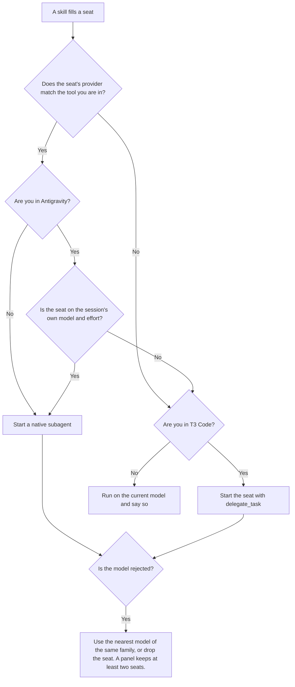

`docs/models.md` assigns a model to each role that a skill fills with a subagent. Edit it by hand. See [[Change a model seat]].

## Value format

Each value is `<provider>/<model> <effort>`.

- The provider is a T3 Code provider instance: `claude`, `codex`, `cursor`, or `antigravity`.
- `inherit-parent` runs the role on the model of the chat that started it.
- No role runs above `xhigh`. Gemini 4 Carbon goes up to `high`.

## How a seat runs

1. If the seat's provider matches the tool you are in, the skill starts a native subagent. A `claude/` seat runs natively in Claude Code, a `codex/` seat in Codex, and a `cursor/` seat in Cursor. In Antigravity, only a seat on the session's own model and effort runs natively, since its subagents cannot pick either.
2. Otherwise, in T3 Code, the skill starts the seat with `delegate_task`.
3. Outside T3 Code, the seat runs on the current model, and the skill says so.
4. If a model is rejected, the skill uses the nearest model of the same family or drops the seat. A panel keeps at least two seats.

This flowchart follows the same rules as the list above.

## Roles

| Role | Default | Used by |
| --- | --- | --- |
| `feature, refactoring` | `claude/claude-opus-5-5 medium` | [Feature](https://github.com/JoshuaHayesWasHere/jstack/blob/main/playbooks/feature.md) and [Refactoring](https://github.com/JoshuaHayesWasHere/jstack/blob/main/playbooks/refactoring.md) playbooks |
| `bug-fix` | `claude/claude-opus-5-5 medium` | [Bug fix](https://github.com/JoshuaHayesWasHere/jstack/blob/main/playbooks/bug-fix.md) playbook |
| `perf-issue` | `claude/claude-opus-5-5 high` | [Perf issue](https://github.com/JoshuaHayesWasHere/jstack/blob/main/playbooks/perf-issue.md) playbook |
| `hillclimb` | `claude/claude-opus-5-5 high` | [Hillclimb](https://github.com/JoshuaHayesWasHere/jstack/blob/main/playbooks/hillclimb.md) playbook |
| `judgment and prose` | `antigravity/gemini-4-neon medium` | Writing and judgment calls |
| `arena runners` | Opus 5.5 high, GPT-6.2 Sol medium, Gemini 4 Carbon medium | [`arena`](https://github.com/JoshuaHayesWasHere/jstack/blob/main/skills/arena/SKILL.md), [`eval`](https://github.com/JoshuaHayesWasHere/jstack/blob/main/playbooks/eval.md) |
| `arena cross-judge pool` | Gemini 4 Neon medium, GPT-6.2 Sol medium, Opus 5.5 medium | [`arena`](https://github.com/JoshuaHayesWasHere/jstack/blob/main/skills/arena/SKILL.md) judge |
| `swarm workers` | `antigravity/gemini-4-neon medium` | [`swarm`](https://github.com/JoshuaHayesWasHere/jstack/blob/main/skills/swarm/SKILL.md), verification, trivial edits |
| `interrogate reviewers` | Sonnet 5.5 high, Gemini 4 Carbon medium, Gemini 4 Neon medium | [`interrogate`](https://github.com/JoshuaHayesWasHere/jstack/blob/main/skills/interrogate/SKILL.md) |
| `council` | Gemini 4 Neon high, GPT-6.2 Sol high, Gemini 4 Carbon medium | [`council`](https://github.com/JoshuaHayesWasHere/jstack/blob/main/skills/council/SKILL.md) |
| `review-loop reviewer` | `antigravity/gemini-4-neon high` | [`review-loop`](https://github.com/JoshuaHayesWasHere/jstack/blob/main/skills/review-loop/SKILL.md) |

The arena judge never comes from the same vendor as the chat that started it. Fable counts as Claude for that rule.

## Choosing effort

Skills start from the role's effort, then adjust it. They raise it one step for the hardest work and lower it for routine work. Fable 5.2 runs outside a panel only when you name it, or after two Opus 5.5 runs of the same task fail their check. The full rules are in `docs/subagents.md`.
