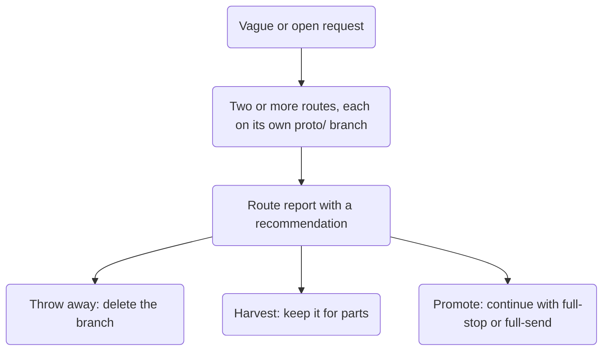
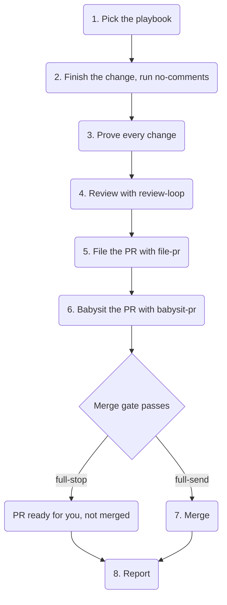

jstack has three modes. Each one is a skill that starts on its phrase. Each reads `docs/rules.md` before its first step.

| | [`prototype`](https://github.com/JoshuaHayesWasHere/jstack/blob/main/skills/prototype/SKILL.md) | [`full-stop`](https://github.com/JoshuaHayesWasHere/jstack/blob/main/skills/full-stop/SKILL.md) | [`full-send`](https://github.com/JoshuaHayesWasHere/jstack/blob/main/skills/full-send/SKILL.md) |
| --- | --- | --- | --- |
| Phrase | "prototype" or `/prototype` | "full stop" | "full send" |
| Purpose | Explore a vague or open request | Build one change to a ready PR | Build one change to a merged PR |
| Branches | `proto/<slug>/<route>`, one per route, cut from your current branch | One feature branch | One feature branch |
| Opens a PR | Never | Yes | Yes |
| Merges | Never | Never | Yes, when the merge gate passes |
| Playbooks | [investigation](https://github.com/JoshuaHayesWasHere/jstack/blob/main/playbooks/investigation.md), [prototype](https://github.com/JoshuaHayesWasHere/jstack/blob/main/playbooks/prototype.md), [runtime-forensics](https://github.com/JoshuaHayesWasHere/jstack/blob/main/playbooks/runtime-forensics.md), [trace-forensics](https://github.com/JoshuaHayesWasHere/jstack/blob/main/playbooks/trace-forensics.md), [eval](https://github.com/JoshuaHayesWasHere/jstack/blob/main/playbooks/eval.md), [multi-phase-plan](https://github.com/JoshuaHayesWasHere/jstack/blob/main/playbooks/multi-phase-plan.md) | [bug-fix](https://github.com/JoshuaHayesWasHere/jstack/blob/main/playbooks/bug-fix.md), [feature](https://github.com/JoshuaHayesWasHere/jstack/blob/main/playbooks/feature.md), [refactoring](https://github.com/JoshuaHayesWasHere/jstack/blob/main/playbooks/refactoring.md), [perf-issue](https://github.com/JoshuaHayesWasHere/jstack/blob/main/playbooks/perf-issue.md), [hillclimb](https://github.com/JoshuaHayesWasHere/jstack/blob/main/playbooks/hillclimb.md), [visual-parity](https://github.com/JoshuaHayesWasHere/jstack/blob/main/playbooks/visual-parity.md), [authoring-a-skill](https://github.com/JoshuaHayesWasHere/jstack/blob/main/playbooks/authoring-a-skill.md) | Same as `full-stop` |
| Ends with | A route report, then a question: throw away, harvest, or promote | PR link, head, proof, review outcome | PR link, merge commit, proof, decisions |
| Source | [`skills/prototype/SKILL.md`](https://github.com/JoshuaHayesWasHere/jstack/blob/main/skills/prototype/SKILL.md) | [`skills/full-stop/SKILL.md`](https://github.com/JoshuaHayesWasHere/jstack/blob/main/skills/full-stop/SKILL.md) | [`skills/full-send/SKILL.md`](https://github.com/JoshuaHayesWasHere/jstack/blob/main/skills/full-send/SKILL.md) |

This flowchart shows a `prototype` run and the three answers you can give for each route.

The [session-pickup](https://github.com/JoshuaHayesWasHere/jstack/blob/main/playbooks/session-pickup.md) and [pause-safely](https://github.com/JoshuaHayesWasHere/jstack/blob/main/playbooks/pause-safely.md) playbooks run in any mode. The [worktree-cleanup](https://github.com/JoshuaHayesWasHere/jstack/blob/main/playbooks/worktree-cleanup.md) playbook runs only when you ask for it by name.

## Rights each mode has

| Action | `prototype` | `full-stop` | `full-send` |
| --- | --- | --- | --- |
| Commit and push its own branches | Yes | Yes | Yes |
| Force-push its own branch with `--force-with-lease` | No | Yes | Yes |
| Run tests, the app, browsers, and screenshots without asking | Yes | Yes | Yes |
| Open a PR | No | Yes | Yes |
| Merge a PR | No | No | This task's PRs only |
| Delete branches or worktrees | Only after you answer | No | No |
| Disable or skip a check | No | No | No |
| Deploy, delete data, message people outside the run | Asks first | Asks first | Asks first |

## Shared steps in `full-stop` and `full-send`

1. Pick the playbook.
2. Finish the change with the playbook's steps. Run [`no-comments`](https://github.com/JoshuaHayesWasHere/jstack/blob/main/skills/no-comments/SKILL.md) on the diff.
3. Prove every change.
4. Get review from [`review-loop`](https://github.com/JoshuaHayesWasHere/jstack/blob/main/skills/review-loop/SKILL.md). Add [`interrogate`](https://github.com/JoshuaHayesWasHere/jstack/blob/main/skills/interrogate/SKILL.md) for a contested design.
5. File the PR with [`file-pr`](https://github.com/JoshuaHayesWasHere/jstack/blob/main/skills/file-pr/SKILL.md). See [[PR descriptions]] for the shape.
6. Babysit the PR with [`babysit-pr`](https://github.com/JoshuaHayesWasHere/jstack/blob/main/skills/babysit-pr/SKILL.md).
7. Merge, in `full-send` only.
8. Report.

This flowchart shows the shared steps and where the two modes part after the merge gate.

## Merge gate

`full-send` merges only when all of these are true on the latest commit:

- The proof covers every change in the diff.
- Required checks pass.
- Review bots have finished. Each finding is fixed or dismissed with a written reason.
- No human review still requests changes.
- The branch is up to date with the default branch, and GitHub reports it as mergeable.

`full-stop` uses the same gate as its readiness check, then stops.
