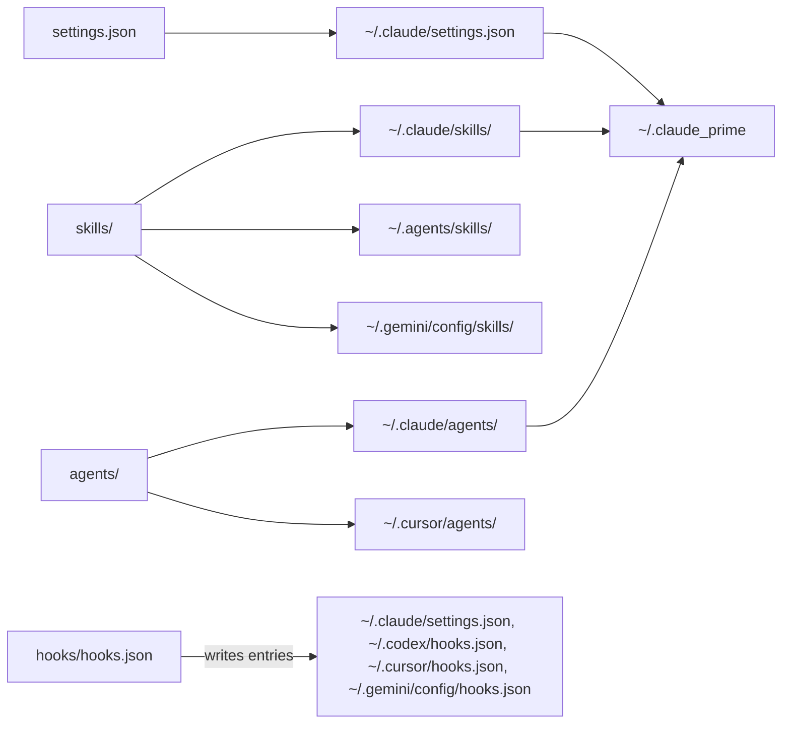

## Files

| Path | Holds |
| --- | --- |
| `skills/<name>/` | One folder per skill, all at one level. Skills open each other by relative path. |
| `playbooks/<title>.md` | The playbooks. See [[Playbooks]]. |
| `agents/comment-sicko.md` | The comment reviewer that [`no-comments`](https://github.com/JoshuaHayesWasHere/jstack/blob/main/skills/no-comments/SKILL.md) starts. |
| `hooks/<script>`, `hooks/hooks.json` | Hook scripts, and the event and matcher each runs on per harness. |
| `docs/rules.md` | Shared rules that the three modes read first. |
| `docs/subagents.md` | Rules for starting subagents, and the rules every subagent reads. |
| `docs/models.md` | The model for each role. See [[Models and seats]]. |
| `docs/harness/` | Maps pstack's Cursor names to Claude Code, Codex, Cursor, and Antigravity. |
| `scripts/worktree-audit.sh` | Sorts worktrees into cleanup buckets. |
| `scripts/publish-wiki` | Copies `wiki/` to the GitHub wiki. |
| `scripts/codex-trust-hooks.mjs` | Trusts the Codex hooks that `install` wrote. |
| `wiki/` | The source of these pages. |
| `settings.example.json` | The published settings template. |
| `settings.json` | The live settings. Not tracked, because it names private config paths. |
| `UPSTREAM.md` | Source commits and every local change. |
| `licenses/` | The MIT licenses for pstack and tstack. |
| `install` | Links everything into place. |

To count the skills, run `ls ~/repos/jstack/skills | wc -l`. The count at this commit is 58.

## What `install` links

| Source | Link |
| --- | --- |
| `settings.json` | `~/.claude/settings.json` |
| `~/.claude/settings.json` | `settings.json` in `~/.claude_prime` |
| `~/.claude/skills`, `~/.claude/agents` | `skills` and `agents` in `~/.claude_prime` |
| `skills/<name>/` | `~/.claude/skills/<name>` for Claude Code, `~/.agents/skills/<name>` for Codex, and `~/.gemini/config/skills/<name>` for Antigravity |
| `agents/<name>.md` | `~/.claude/agents/<name>.md` and `~/.cursor/agents/<name>.md` |
| `hooks/hooks.json` | Hook entries in `~/.claude/settings.json`, `~/.codex/hooks.json`, `~/.cursor/hooks.json`, and `~/.gemini/config/hooks.json` |

This flowchart shows the same links. Hook entries are written into each file, not linked.

Cursor reads both `~/.claude/skills` and `~/.agents/skills`.

## Installer behavior

- It copies `settings.example.json` to `settings.json` when `settings.json` is missing.
- It removes dead links in the skill and agent folders before it links.
- It never replaces a real file or folder. It prints `conflict` and skips that path.
- `--dry-run` prints the changes without making them. A second run prints nothing.
- It rewrites only the hook entries it owns, and trusts its own Codex hooks, since Codex skips an untrusted hook without a word.
