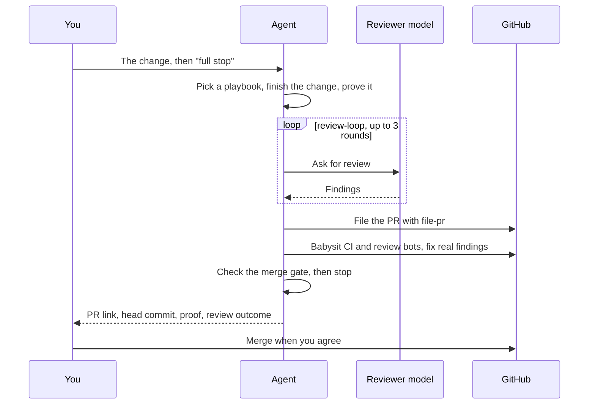

Use this guide to take a change to a pull request with the [`full stop`](https://github.com/JoshuaHayesWasHere/jstack/blob/main/skills/full-stop/SKILL.md) or [`full send`](https://github.com/JoshuaHayesWasHere/jstack/blob/main/skills/full-send/SKILL.md) mode.

## Pick the mode

- If you want to review and merge the PR yourself, say "full stop".
- If you want the agent to merge it without you, say "full send".
- If you do not yet know what to build, start with "prototype" instead. See [[Your first prototype]].

## Give the task

1. Start the agent in the repository.
2. State the change and the mode in one message:

	```
	the export button drops the last row of the table. fix it. full stop
	```

3. Leave the agent to work. It does not need you unless it asks a question.

This sequence diagram shows a `full stop` run from your message to your merge.



The agent picks a playbook, such as [Bug fix](https://github.com/JoshuaHayesWasHere/jstack/blob/main/playbooks/bug-fix.md) or [Feature](https://github.com/JoshuaHayesWasHere/jstack/blob/main/playbooks/feature.md), and copies its steps into a todo list. You see the list in its first reply.

## Answer questions

The agent asks only when it cannot continue alone. It uses the harness's question tool, so the thread shows that it is waiting. Typical reasons:

- It cannot prove the change.
- The next step needs a right the mode does not grant, such as deleting data.
- The goal could mean two different results.

## Read the handoff

- After "full stop", the final message has the PR link, the head commit, the proof, and the review outcome. The PR is open and not merged. Merge it when you agree.
- After "full send", the final message has the PR link, the merge commit, the proof, and each decision the agent made for you.

Both modes write the PR description in the shape on [[PR descriptions]]. For the rights each mode has, see [[Modes]]. For the steps a playbook runs, see [[Playbooks]].
