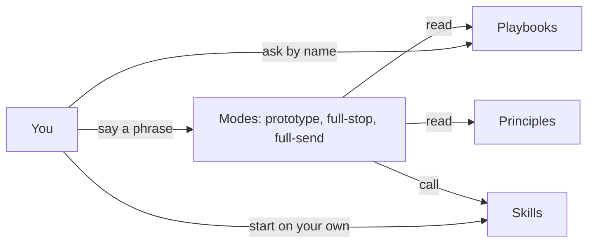
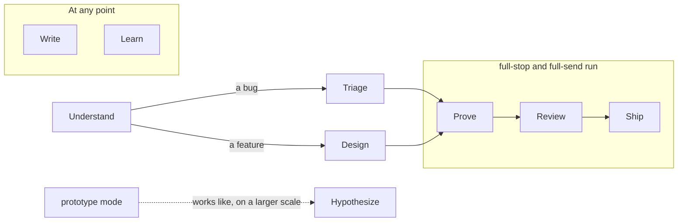

jstack has three layers:

1. **Modes.** [`prototype`](https://github.com/JoshuaHayesWasHere/jstack/blob/main/skills/prototype/SKILL.md), [`full-stop`](https://github.com/JoshuaHayesWasHere/jstack/blob/main/skills/full-stop/SKILL.md), and [`full-send`](https://github.com/JoshuaHayesWasHere/jstack/blob/main/skills/full-send/SKILL.md) take a request from start to finish. See [[Modes]].
2. **Library.** [[Playbooks]] and [[Principles]] are what the modes read. You can also ask for a playbook by name.
3. **Skills.** The skills on this page. A mode calls them as it works, and you can start any of them on your own.

This diagram shows how the three layers connect.

The groups follow the work, in order. A bug starts at [Understand](#understand) and [Triage](#triage). A feature starts at [Understand](#understand) and goes to [Design](#design). The `prototype` mode works like [Hypothesize](#hypothesize) on a larger scale. `full-stop` and `full-send` run [Prove](#prove), [Review](#review), and [Ship](#ship). [Write](#write) and [Learn](#learn) apply at any point.

This flowchart shows the skill groups in work order.

In the **Starts** column:

- **Typed** means the skill runs only when you type its name, such as `/how`.
- **Phrase** means it also starts when you say its phrase.
- **Automatic** means the agent runs it on its own when it applies.

## Understand

Find out what is going on. None of these change code.

| Skill | Starts | Does | Source |
| --- | --- | --- | --- |
| [`how`](https://github.com/JoshuaHayesWasHere/jstack/blob/main/skills/how/SKILL.md) | Typed | Explains how a subsystem works, where code lives, and which layer owns it. | pstack |
| [`why`](https://github.com/JoshuaHayesWasHere/jstack/blob/main/skills/why/SKILL.md) | Typed | Explains why code is the way it is, from the commits and PR discussions. Marks its own guesses. | pstack |
| [`teach`](https://github.com/JoshuaHayesWasHere/jstack/blob/main/skills/teach/SKILL.md) | Typed | Runs `how` and `why`, then explains the work plainly, one diagram at a time. | pstack |
| [`recall`](https://github.com/JoshuaHayesWasHere/jstack/blob/main/skills/recall/SKILL.md) | Typed | Rebuilds your recent context on a topic from your chat history and live state. | pstack |
| [`ketchup`](https://github.com/JoshuaHayesWasHere/jstack/blob/main/skills/ketchup/SKILL.md) | Typed | Catches you up on what changed in the chat since your last message. Lists every item that waits on you. | pstack |

## Triage

Pin down what is broken.

| Skill | Starts | Does | Source |
| --- | --- | --- | --- |
| [`tdd`](https://github.com/JoshuaHayesWasHere/jstack/blob/main/skills/tdd/SKILL.md) | Typed | Writes the failing test first, then the fix, when the bug has a cheap local test. | pstack |

## Design

Decide what to build before you build it.

| Skill | Starts | Does | Source |
| --- | --- | --- | --- |
| [`sharpen`](https://github.com/JoshuaHayesWasHere/jstack/blob/main/skills/sharpen/SKILL.md) | Typed | Rewrites your prompt to ask for more depth: what an expert would also do, the material they would start from, and how to check the result. It does not do the task. | pstack |
| [`in-your-own-words`](https://github.com/JoshuaHayesWasHere/jstack/blob/main/skills/in-your-own-words/SKILL.md) | Typed | Restates your goal and the problem behind it before any work starts. | pstack |
| [`architect`](https://github.com/JoshuaHayesWasHere/jstack/blob/main/skills/architect/SKILL.md) | Typed | Settles types, signatures, and module shape before code crosses a function boundary. Stays involved while the code is written. | pstack |
| [`statechart`](https://github.com/JoshuaHayesWasHere/jstack/blob/main/skills/statechart/SKILL.md) | Typed | Checks a TLA+ model of a system that moves between states and draws it as a Mermaid statechart. Shows the shortest path to each state that breaks a rule. | pstack |

## Hypothesize

Try several approaches at once and compare them.

| Skill | Starts | Does | Source |
| --- | --- | --- | --- |
| [`swarm`](https://github.com/JoshuaHayesWasHere/jstack/blob/main/skills/swarm/SKILL.md) | Typed | Starts N parallel workers on separate slices, then returns one report. | pstack |
| [`arena`](https://github.com/JoshuaHayesWasHere/jstack/blob/main/skills/arena/SKILL.md) | Typed | Starts N parallel attempts at one task, picks the best as a base, and copies in the best parts of the others. | pstack |

`swarm` and `arena` choose their models from `docs/models.md`. See [[Models and seats]].

## Prove

Show that the change works, with evidence you can rerun.

| Skill | Starts | Does | Source |
| --- | --- | --- | --- |
| [`blast-radius`](https://github.com/JoshuaHayesWasHere/jstack/blob/main/skills/blast-radius/SKILL.md) | Typed | Finds what a small change could break outside the diff. Proves the one fact that makes it safe by running code. | pstack |
| [`benchmark-checklist`](https://github.com/JoshuaHayesWasHere/jstack/blob/main/skills/benchmark-checklist/SKILL.md) | Typed | Checks a measured number before anyone reports it or acts on it. | pstack |
| [`create-verification-skill`](https://github.com/JoshuaHayesWasHere/jstack/blob/main/skills/create-verification-skill/SKILL.md) | Typed | Writes a project skill that drives your app the way a user does, so agents can prove changes. | pstack |
| [`maintain-verification-skill`](https://github.com/JoshuaHayesWasHere/jstack/blob/main/skills/maintain-verification-skill/SKILL.md) | Typed | Brings that project skill back in line with the app. Opens at most one PR of proven corrections. | pstack |
| [`create-formal-verification-skill`](https://github.com/JoshuaHayesWasHere/jstack/blob/main/skills/create-formal-verification-skill/SKILL.md) | Typed | Proves one property of hard code, such as a race or a retry, with a model checker or proof tool. Writes a project skill that checks it again on each change. | pstack |
| [`maintain-formal-verification-skill`](https://github.com/JoshuaHayesWasHere/jstack/blob/main/skills/maintain-formal-verification-skill/SKILL.md) | Typed | Updates the formal model after the code changes. Says whether each failure is drift or a real bug. | pstack |

## Review

Get a second opinion before the change ships.

| Skill | Starts | Does | Source |
| --- | --- | --- | --- |
| [`review-loop`](https://github.com/JoshuaHayesWasHere/jstack/blob/main/skills/review-loop/SKILL.md) | Phrase: "review loop", "`<model>` loop", or "`<model>` loop review" (such as "neon loop", "sol loop", "sol loop review", "opus loop", "fable loop") | Gets review from the named model (defaulting to Gemini 4 Neon, or the `review-loop reviewer` seat) in a loop until both agents agree. Does not trigger on generic loop mentions or ordinary review requests. | tstack |
| [`council`](https://github.com/JoshuaHayesWasHere/jstack/blob/main/skills/council/SKILL.md) | Phrase: "council" | Gets review from the three models on the `council` line in `docs/models.md`. Loops until all three agree. | tstack |
| [`interrogate`](https://github.com/JoshuaHayesWasHere/jstack/blob/main/skills/interrogate/SKILL.md) | Typed | Has models from different vendors try to break a diff. Keeps only the findings a run proves. | pstack |
| [`no-comments`](https://github.com/JoshuaHayesWasHere/jstack/blob/main/skills/no-comments/SKILL.md) | Typed | Starts the `comment-sicko` agent to strip comments from a diff, then fixes the findings you accept. | pstack |

`review-loop`, `council`, and `interrogate` take their models from `docs/models.md`. See [[Models and seats]].

## Ship

Take the change to a pull request and through to merge.

| Skill | Starts | Does | Source |
| --- | --- | --- | --- |
| [`file-pr`](https://github.com/JoshuaHayesWasHere/jstack/blob/main/skills/file-pr/SKILL.md) | Phrase: "file a PR" | Opens a PR in jstack's standard shape for every repo: a title that says what the user gets, a screenshot first, the problem as a real situation, what changed, evidence from the real app, and what was and was not verified. Written through `unslop` and `bro`. See [[PR descriptions]]. | tstack |
| [`babysit-pr`](https://github.com/JoshuaHayesWasHere/jstack/blob/main/skills/babysit-pr/SKILL.md) | Phrase: "babysit" | Watches a PR through CI and review bots and fixes real findings. Uses one watcher per PR. | tstack |
| [`leaving-pr-comments`](https://github.com/JoshuaHayesWasHere/jstack/blob/main/skills/leaving-pr-comments/SKILL.md) | Automatic | Formats any comment an agent posts on GitHub for you. | tstack |
| [`show-me-your-work`](https://github.com/JoshuaHayesWasHere/jstack/blob/main/skills/show-me-your-work/SKILL.md) | Typed | Keeps a TSV log with one row per decision on long or unattended runs, so a reviewer can follow the choices. | pstack |

`file-pr` and `babysit-pr` call `leaving-pr-comments`.

## Write

Make prose clear. Use these at any point.

| Skill | Starts | Does | Source |
| --- | --- | --- | --- |
| [`technical-writing`](https://github.com/JoshuaHayesWasHere/jstack/blob/main/skills/technical-writing/SKILL.md) | Typed | The writing standard for docs, READMEs, PR descriptions, and commit messages. | pstack |
| [`unslop`](https://github.com/JoshuaHayesWasHere/jstack/blob/main/skills/unslop/SKILL.md) | Typed | Removes signs of AI writing from text. | pstack |
| [`bro`](https://github.com/JoshuaHayesWasHere/jstack/blob/main/skills/bro/SKILL.md) | Typed | Restates the last message in plain words. | pstack |

## Learn

Make agents do better next time.

| Skill | Starts | Does | Source |
| --- | --- | --- | --- |
| [`reflect`](https://github.com/JoshuaHayesWasHere/jstack/blob/main/skills/reflect/SKILL.md) | Typed | Reads the current chat for lessons and turns each one into an edit to an existing skill. | pstack |
| [`correct`](https://github.com/JoshuaHayesWasHere/jstack/blob/main/skills/correct/SKILL.md) | Typed | Finds mistakes that agents keep repeating in a repository and makes each one impossible. Tries architecture, then types, then a lint, then a test, and writes docs last. | pstack |
