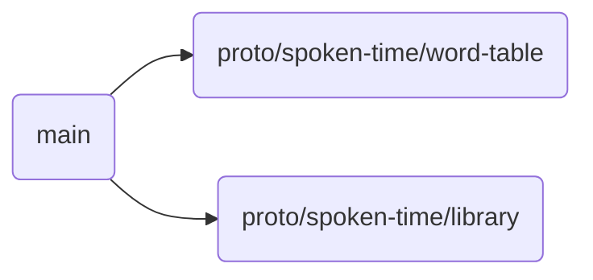

In this tutorial, you ask an agent to explore a small idea with the [`prototype`](https://github.com/JoshuaHayesWasHere/jstack/blob/main/skills/prototype/SKILL.md) mode. You end with two or more throwaway branches, a report that compares them, and a choice about what to keep.

You need jstack installed. If `ls ~/.claude/skills/prototype` prints `SKILL.md`, it is. If not, do [[Install jstack]] first.

## 1. Make a practice repository

Create a small repository so the agent's branches cannot touch real work.

```sh
mkdir -p ~/desk/proto-demo && cd ~/desk/proto-demo
git init -b main
printf 'import datetime\nprint(datetime.datetime.now())\n' > when.py
git add when.py && git commit -m "Print the time"
```

Run `python3 when.py`. You see a timestamp such as `2026-11-17 14:03:11.482193`.

## 2. Start an agent in the repository

```sh
claude
```

You see the Claude Code prompt. Codex, Cursor, and Antigravity work the same way.

## 3. Ask for a prototype

Type a vague request that starts with the mode's name:

```
prototype: make when.py tell the time in a way a person would say it out loud
```

The agent's first message restates your goal in its own words. It names the question the prototype must settle and lists the routes it plans to try. It does not wait for you to reply.

## 4. Watch the routes appear

Open a second terminal in the same folder and list the branches:

```sh
git branch --list 'proto/*'
```

You see one branch per route, such as `proto/spoken-time/word-table` and `proto/spoken-time/library`. Each route runs in its own worktree. `git worktree list` shows them.

This diagram shows the two route branches cut from `main`.



## 5. Read the report

When the routes finish, the agent posts a report. It has a table with one row per route: the branch, the approach, what the agent saw when it ran the route, and a verdict. A recommendation comes last.

## 6. Decide what to keep

The agent asks you about each route with three options:

- **Throw away** deletes the branch and its worktree.
- **Harvest** keeps the branch so you can copy parts of it later.
- **Promote** continues that route with [`full stop`](https://github.com/JoshuaHayesWasHere/jstack/blob/main/skills/full-stop/SKILL.md) or [`full send`](https://github.com/JoshuaHayesWasHere/jstack/blob/main/skills/full-send/SKILL.md).

Pick **Throw away** for every route. Run `git branch --list 'proto/*'` again. The list is empty.

## What you did

You ran the `prototype` mode end to end: a restated goal, parallel routes on their own branches, a report with evidence, and a decision that stayed with you. To build a change for real, go to [[Ship a change]]. To see what each mode may do, read [[Modes]].
